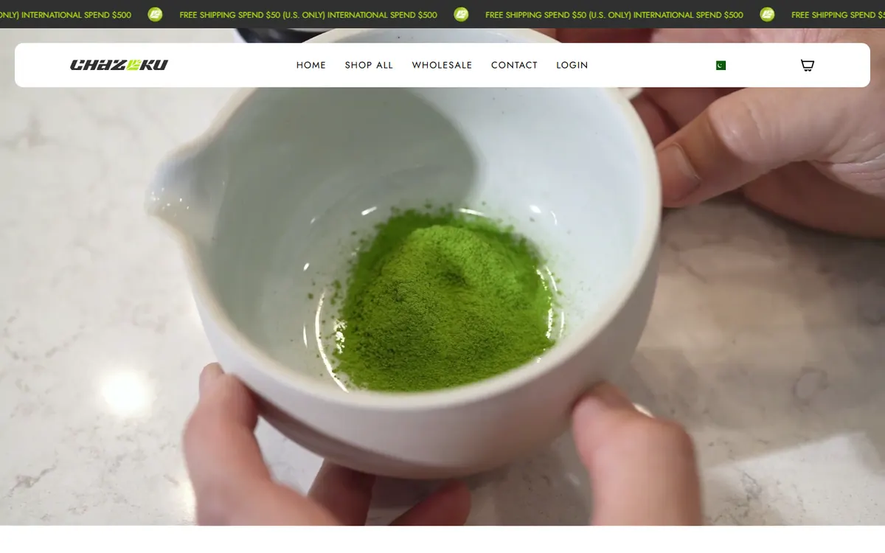

# Shopify × Recharge subscription bridge

A Node server for Shopify App Proxy requests that decides first-order gift eligibility from Recharge history.

**Live site:** https://chazoku.com  
**Portfolio:** https://izainpasha.github.io

## The problem
Chazoku offers an intro gift only to first-time subscribers, which Shopify and Recharge can't decide on their own.

## What I built
A Node service that verifies Shopify App Proxy signatures and logged-in customer IDs, checks Recharge customer history for gift eligibility, creates short-lived Recharge portal sessions, and verifies Recharge webhooks without exposing credentials to theme code.

## Result
Subscription and gift add to the cart as one bundle, with eligibility decided server-side.

## Stack
Node.js · Shopify App Proxy · Recharge API · Webhooks

---

Built by [Syed Zain Pasha](https://izainpasha.github.io) — full-stack and Shopify developer. Client data, credentials and environment files are not included.
